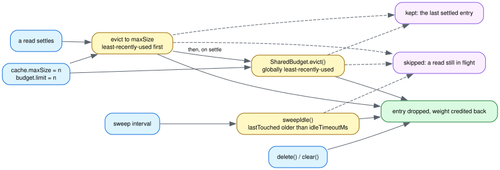

# Bounding what the cache retains

[eviction.dot](img/eviction.dot) is the source; see
[CONTRIBUTING.md](../CONTRIBUTING.md) for how to re-render it.

Four mechanisms drop an entry, each for a different reason. `maxSize` is a
ceiling the cache checks when a read settles. `idleTimeoutMs` is the only
reclamation that runs between calls. A `SharedBudget` bounds several caches in
aggregate, which no per-cache ceiling can do. `delete()` and `clear()` drop
entries when the consumer asks.

The three automatic mechanisms never drop a read still in flight, which has no
weight to reclaim and whose waiters rely on its de-duplication. `maxSize` and a
`SharedBudget` also keep a cache's last settled entry, which the caller needs
for the request in flight; the idle sweep does not, because its purpose is to
reclaim everything from a cache nobody is reading. So the worst any budget can
cost is a re-read: the cache never refuses a value for being too large.

## Why `sizeOf`

The package exists because four gmod packages each hand-rolled this cache,
identical except for how they weighed an entry: `@gmod/bam` and `@gmod/tabix`
weigh decompressed bytes, `@gmod/bbi` weighs entries, and `@gmod/cram` weighed
decoded records before it measured a decoded slice in bytes. The cache cannot
call `sizeOf` until a read settles, so a cache that budgets this way has to own
its entries, which is why a plain-LRU-backed package could not serve them.

Omit `sizeOf` and the budget counts entries.

## Set `maxSize` generously

A budget set below one request's working set does not cache less; it caches
_nothing_. The cache evicts each value before the next request can reuse it,
while the reads in flight retain their memory anyway. That cliff is the reason
the per-cache default is `Infinity`, since a sensible limit depends entirely on
what is being cached.

Unbounded is the permissive default, not the safe one. With no budget the cache
grows for the life of the object; `@gmod/tabix` measured 2 GB RSS panning a
dense VCF before it bounded this
([tabix-js/docs/caching.md](https://github.com/GMOD/tabix-js/blob/main/docs/caching.md#chunkcachesize-never-refuses-a-read),
which also has what a pinned budget twenty times under the default cost: 47
refills out of 47 against 0).

`cache.maxSize = n` is an accessor, not a field, so lowering it evicts
immediately. When `maxSize` was a plain field, lowering it did nothing until the
next read ran the eviction loop, which never happens on an idle consumer,
although a consumer lowers `maxSize` precisely to shed memory under pressure.

## `idleTimeoutMs` turns the ceiling into a peak

The cache checks `maxSize` when a read settles, so an idle cache stays at
whatever level it reached and never releases that memory. For an object that
lives as long as its UI, such as a genome browser parked on a region with a
cache per open track, that resting level is the memory that matters, and no
ceiling alone will lower it. With `idleTimeoutMs`, `maxSize` limits the peak,
and the idle sweep lowers the resting level.

The clock runs from the last **read** of an entry, or from its fill settling if
nothing has read it since, so something fetched once and used every second never
expires. The sweep skips reads in flight, and a slow read still gets its full
timeout for reuse because the clock starts after its download ends.

The interval is a quarter of the timeout, bounding the lag between an entry
going idle and being reclaimed at about 1.25x rather than 2x. The interval is
never shorter than a second, so a timeout under four seconds lags by up to that
second instead. `sweepIdle()` reclaims on demand, for example when a tab goes
hidden, instead of waiting for the interval. `@gmod/bam` measured a pan that
held 331 MB going to 0 MB once idle
([ADR 0015](https://github.com/GMOD/bam-js/blob/main/agent-docs/architecture-decision-records/0015-reclaim-the-chunk-cache-when-nothing-is-using-it.md)).

The timer needs no `dispose()` call. The first read to _settle_ arms it, and the
first sweep that finds no settled entry left stops it, so it runs only while it
has something to reclaim, and it `unref`s itself where that exists. It holds the
cache through a `WeakRef`, so a cache that the consumer drops without clearing
is garbage-collected like anything else, and the timer clears itself on its next
tick. When the timer held the cache strongly, it kept a dropped cache alive, and
charged to its `SharedBudget`, for a whole idle timeout; jbrowse measured a
closed alignments track holding 296 MB for four minutes that way.

The stop condition is "nothing settled left", not "the map is empty". The sweep
never removes a read that never settles, such as a stalled fetch on a dead
connection, which is exactly when a consumer gives up. With an empty-map
condition, that one hung read kept the timer, the cache and everything its fill
closed over alive forever.

## One eviction policy

Versions before 2.0 offered `evictionPolicy: 'batch'`, which deferred eviction
until no read was in flight and then spared everything that batch had touched.
`@gmod/cram` adopted it on a 117ms-against-12ms measurement taken with a budget
2.75x below the request's working set, and dropped it once raising the budget
above the working set made the two policies measurably identical. `@gmod/bam`
measured that it did not rescue an undersized budget either, while retaining
1.7x the memory. No consumer set it after that, so 2.0 removed it. Size the
budget above one request instead. Both measurements are written up in
[cram-js ADR 0005](https://github.com/GMOD/cram-js/blob/main/docs/adr/0005-drop-the-batch-eviction-policy.md)
and
[bam-js ADR 0013](https://github.com/GMOD/bam-js/blob/main/agent-docs/architecture-decision-records/0013-the-batch-eviction-policy-does-not-transfer.md).

## `SharedBudget` — when the cache count is a property of the workload

A per-cache ceiling does not bound a consumer that scales the number of caches.
`@gmod/bam`'s 1 GB default is sized so a single track's pan never thrashes;
jbrowse holds one `BamFile` per open track, and three moderately deep alignment
tracks browsing eight windows measured 1109 MB retained and 1665 MB RSS with
**no cache anywhere near its own ceiling**, so the budget caused none of it.

Dividing the ceiling by the file count re-creates the cliff above. On that same
three-track workload, 1 GB split as 342 MB each cost 16 refills on the revisit;
split eight ways as 128 MB each it cost 101, against 98 for the cold pass, which
is worse than no cache at all. A shared budget avoids that failure, because a
member gives up only what is _globally_ least-recently-used. Entries from tracks
the reader is not looking at become the oldest and go first, which frees space
for the track being panned, so the active track keeps a working set whatever the
track count.
[bam-js ADR 0018](https://github.com/GMOD/bam-js/blob/main/agent-docs/architecture-decision-records/0018-a-per-file-ceiling-is-not-a-bound-on-a-consumer-with-many-files.md)
records the workload, the split and the refill counts, and is why this class
exists.

Before using a `SharedBudget`, note two things:

- Every member must weigh in the same unit. `total` is a sum over members, so it
  means nothing unless their `sizeOf` units agree, and across these packages
  they do not. A budget holding a bam cache (bytes) and a bbi cache (entries)
  would be adding bytes to entries and bounding neither. `sizeOf` is opaque by
  design, so the cache cannot detect a mismatch at runtime. Group members by
  unit, with one budget per group.
- A budget works alongside `maxSize` rather than replacing it. A cache that
  passes only a budget is unbounded on its own and bounded in aggregate, which
  is usually what you want, because sharing lets one busy member use most of the
  total. Each cache gets under its own ceiling first and only then competes for
  the shared one.

The budget holds its members weakly. The consumer it was built for keeps one
budget per worker and one cache per open track, and closing a track frees its
memory by dropping the last reference to the adapter. A budget that held its
members strongly would turn that into a leak with no error. The budget keeps a
`WeakRef` and the member's last known weight beside it instead, so a collected
member is pruned and its weight credited back on the next pass, and there is no
`unregister` to forget.

## Why entries have a sequence number as well as a timestamp

`lastTouched` is wall-clock, which the idle sweep needs. It cannot order
evictions: `Date.now()` has millisecond resolution, so a burst of cache hits
inside one millisecond all get the same stamp and a tie resolves to whichever
member the budget happened to scan last. `seq` is a counter ticked on every
touch, giving a total order across _different_ caches, which a shared budget
compares. `lastTouched` answers "how long since" and `seq` answers "which came
first", so the cache keeps both.

For the same reason, a read settling stamps `lastTouched` but deliberately does
not `touch()` the entry. A read's latency is a property of the transport, not of
how the consumer is using the cache, so ordering evictions by it preferentially
keeps whatever was slowest to arrive. In `@gmod/tabix` that is the largest chunk
in the query, which is the last thing a budget should retain.

## Limits

The budget bounds retained weight, not the heap. Reads in flight are never
evicted, a query holds everything it parsed until it returns whether or not the
cache still does, and a value weighed once at settle can grow afterwards.
`@gmod/bam` memoizes `end`, `CIGAR` and `tags` onto a record the first time a
renderer touches them, and measured +38% over the weighed size. Size these
against what you want to _keep_, and bound total memory somewhere that can see
the whole process.

Each consumer's caching doc has a section on this, with its own numbers:
[bam-js](https://github.com/GMOD/bam-js/blob/main/docs/caching.md#none-of-them-bound-peak-memory)
and
[tabix-js](https://github.com/GMOD/tabix-js/blob/main/docs/caching.md#none-of-these-bound-peak-memory).
[consumers.md](consumers.md) maps the rest of the measurements to where they
were taken.
